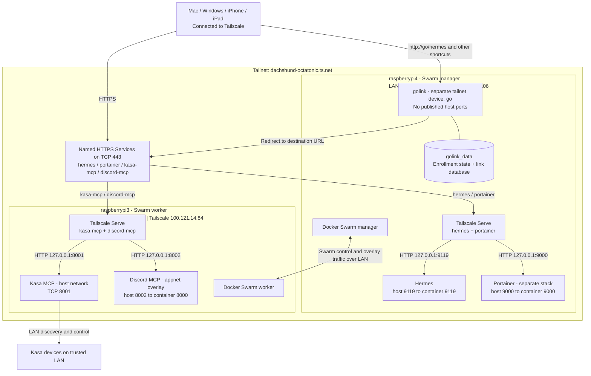

# HomeLab

Docker services for the home lab, managed with Portainer on a two-node Docker
Swarm.

## Current network configuration

The lab uses the `dachshund-octatonic.ts.net` tailnet for private application
access. Tailscale runs directly on both Pis. Each Pi advertises named HTTPS
Services that forward to local application ports. Clients must be connected to
the tailnet and allowed by its access policy. TLS terminates in Tailscale Serve;
the hop from Serve to each local backend uses HTTP.

Docker Swarm continues to use the reserved LAN addresses for cluster traffic
and the `appnet` overlay network. Tailscale does not replace Swarm networking.

| Host | Role | Reserved LAN IP | Tailscale IP |
| --- | --- | --- | --- |
| `raspberrypi4` | Swarm manager; Hermes, Portainer, golink | `192.168.86.49` | `100.93.9.106` |
| `raspberrypi3` | Swarm worker; Kasa MCP, Discord MCP | `192.168.86.80` | `100.121.14.84` |

Use DHCP reservations to retain the LAN addresses. Keep the Pi 4 as the only
manager; two nodes do not provide control-plane high availability. Run
`docker stack`, `docker service`, and `docker node` management commands on the
Pi 4. Worker-node errors for these commands on the Pi 3 are expected.



Golink redirects the client to an application; it does not carry application
traffic after the redirect.

### Service routes and ports

| Tailscale Service | Client URL | Service host | Local HTTP backend |
| --- | --- | --- | --- |
| `svc:hermes` | `https://hermes.dachshund-octatonic.ts.net` | Pi 4 | `127.0.0.1:9119` |
| `svc:portainer` | `https://portainer.dachshund-octatonic.ts.net` | Pi 4 | `127.0.0.1:9000` |
| `svc:kasa-mcp` | `https://kasa-mcp.dachshund-octatonic.ts.net/mcp` | Pi 3 | `127.0.0.1:8001` |
| `svc:discord-mcp` | `https://discord-mcp.dachshund-octatonic.ts.net/mcp` | Pi 3 | `127.0.0.1:8002` |

Hermes and Discord use `mode: host` port publishing, so their ports are exposed
only on the node running their task, rather than through the Swarm routing
mesh. Discord's application still listens on container port `8000`; host port
`8002` avoids the existing Portainer port `8000`. Kasa uses the host network
and listens directly on `8001`, with no Docker port mapping.

These backend ports are reachable on their hosts' LAN interfaces too; forwarding
to `127.0.0.1` in Serve does not make a published Docker port loopback-only.
The separate Portainer stack currently publishes ports `8000`, `9000`, and
`9443` through Swarm ingress. Its Tailscale route uses HTTP port `9000`.
Both MCP allowlists include their tailnet names and local backend addresses.

The `appnet` overlay connects Hermes, Discord, and golink.
Kasa and AirConnect use the external Docker `host` network for LAN access.
AirConnect has no placement constraint in the current Compose file.

### Tailnet go links

The `golink` service runs on the Pi 4 and joins Tailscale as a separate device
named `go`. It needs no published host ports. The `golink_data` volume stores
its enrollment state and link database; preserve it and back it up. This is a
regular tailnet device, not an additional `svc:go` Service.

For initial enrollment:

1. Generate an auth key in [Tailscale Keys](https://login.tailscale.com/admin/settings/keys).
   Use `tag:homelab`, disable Reusable and Ephemeral, and enable Pre-approved
   if available. A one-day key expiration is sufficient for enrollment.
2. Set `GOLINK_TS_AUTHKEY` in the Portainer `homelab` stack environment and
   redeploy from the updated Compose file. Never commit the key.
3. Wait for `go` to appear online in Tailscale Machines; approve it if required.
4. Remove the environment variable and redeploy. Enrollment persists in the
   volume, so the key is no longer needed.

With MagicDNS enabled, open `http://go/` from a connected client and create:

| Shortcut | Destination |
| --- | --- |
| `http://go/hermes` | `https://hermes.dachshund-octatonic.ts.net` |
| `http://go/portainer` | `https://portainer.dachshund-octatonic.ts.net` |
| `http://go/kasa` | `https://kasa-mcp.dachshund-octatonic.ts.net/mcp` |
| `http://go/discord` | `https://discord-mcp.dachshund-octatonic.ts.net/mcp` |

Include `http://` if the browser treats a bare `go/hermes` as a search. The full
node name is `go.dachshund-octatonic.ts.net`. Use full HTTPS destination URLs
in MCP clients; MCP endpoints are protocol endpoints, not browser dashboards.

See the [official golink documentation](https://github.com/tailscale/golink).

## 1. Verify the operating system

Run on both Pis:

```bash
dpkg --print-architecture
uname -m
cat /etc/os-release
```

The preferred architecture is `arm64` / `aarch64`. Using Raspberry Pi OS Lite
64-bit on both machines avoids many container-image compatibility problems.

## 2. Set hostnames and reserve addresses

On the Pi 4:

```bash
sudo raspi-config
```

Select **System Options > Hostname**, set it to `raspberrypi4`, and reboot.

On the Pi 3, follow the same process using `raspberrypi3`. Then create DHCP
reservations for both devices in the router.

Verify the configuration on each Pi:

```bash
hostname
hostname -I
```

Verify connectivity from the Pi 4:

```bash
ping -c 3 192.168.86.80
```

Verify connectivity from the Pi 3:

```bash
ping -c 3 192.168.86.49
```

## 3. Update both Pis

```bash
sudo apt-get update
sudo apt-get full-upgrade -y
sudo reboot
```

## 4. Install Docker on both Pis

Raspberry Pi OS 64-bit uses Debian's `arm64` packages. Remove any stale Docker
repository definition, then add Docker's Debian signing key:

```bash
sudo rm -f /etc/apt/sources.list.d/docker.list
sudo apt-get update
sudo apt-get install -y ca-certificates curl
sudo install -m 0755 -d /etc/apt/keyrings
sudo curl -fsSL https://download.docker.com/linux/debian/gpg \
  -o /etc/apt/keyrings/docker.asc
sudo chmod a+r /etc/apt/keyrings/docker.asc
```

Add Docker's Debian package repository. This supports Debian 13 `trixie` on
`arm64`:

```bash
echo \
  "deb [arch=$(dpkg --print-architecture) signed-by=/etc/apt/keyrings/docker.asc] https://download.docker.com/linux/debian \
  $(. /etc/os-release && echo "$VERSION_CODENAME") stable" |
  sudo tee /etc/apt/sources.list.d/docker.list > /dev/null
```

Install Docker Engine and Compose:

```bash
sudo apt-get update
sudo apt-get install -y \
  docker-ce \
  docker-ce-cli \
  containerd.io \
  docker-buildx-plugin \
  docker-compose-plugin
sudo usermod -aG docker "$USER"
sudo reboot
```

After reconnecting, verify the installation:

```bash
docker version
docker compose version
docker run --rm hello-world
```

See the official [Docker Engine installation instructions for
Debian](https://docs.docker.com/engine/install/debian/) for updates. Docker's
Raspberry Pi OS-specific repository is intended for 32-bit `armhf`; 64-bit
Raspberry Pi OS should use the Debian `arm64` repository.

## 5. Allow Swarm traffic on the trusted LAN

Swarm and Portainer require the following traffic between the nodes:

| Port | Protocol | Purpose |
| --- | --- | --- |
| `2377` | TCP | Swarm control plane |
| `7946` | TCP and UDP | Node discovery |
| `4789` | UDP | Overlay network data |
| `9001` | TCP | Portainer agents |
| `9443` | TCP | Portainer web interface |

Do not expose ports `2377`, `7946`, `4789`, or `9001` through the internet-facing
router. In particular, UDP port `4789` must only be reachable from a trusted
network.

Raspberry Pi OS normally does not enable UFW. Check its status:

```bash
sudo ufw status
```

If UFW is active, allow node traffic between hosts on the trusted LAN:

```bash
sudo ufw allow from 192.168.86.0/24 to any port 2377 proto tcp
sudo ufw allow from 192.168.86.0/24 to any port 7946 proto tcp
sudo ufw allow from 192.168.86.0/24 to any port 7946 proto udp
sudo ufw allow from 192.168.86.0/24 to any port 4789 proto udp
sudo ufw allow from 192.168.86.0/24 to any port 9001 proto tcp
sudo ufw allow from 192.168.86.0/24 to any port 9443 proto tcp
```

See Docker's [Swarm port
requirements](https://docs.docker.com/engine/swarm/swarm-tutorial/) for details.

## 6. Create the Swarm

Run only on `raspberrypi4`, substituting its actual reserved address:

```bash
docker swarm init --advertise-addr 192.168.86.49
```

Docker prints a worker join command containing a token. Treat this token like a
password and do not publish it. To display it again later, run this on the
manager:

```bash
docker swarm join-token worker
```

Run the generated join command on `raspberrypi3`. It will resemble:

```bash
docker swarm join --token YOUR_ACTUAL_WORKER_TOKEN 192.168.86.49:2377
```

Back on the manager, verify that both nodes are ready:

```bash
docker node ls
```

The Pi 4 should show `Leader`; the Pi 3 should have no manager status.

## 7. Label the nodes

Run on `raspberrypi4`:

```bash
docker node update --label-add hardware=pi4 raspberrypi4
docker node update --label-add hardware=pi3 raspberrypi3
docker node update --label-add storage=primary raspberrypi4
```

Verify the labels:

```bash
docker node inspect raspberrypi4 --pretty
docker node inspect raspberrypi3 --pretty
```

## 8. Test scheduling and ingress

On `raspberrypi4`:

```bash
docker service create \
  --name swarm-test \
  --replicas 2 \
  --publish published=8080,target=80 \
  nginx:alpine
docker service ps swarm-test
```

After both replicas are running, open either node address:

- `http://192.168.86.49:8080`
- `http://192.168.86.80:8080`

Remove the test service:

```bash
docker service rm swarm-test
```

## 9. Install Portainer CE

Run only on `raspberrypi4`:

```bash
curl -L \
  https://downloads.portainer.io/ce-lts/portainer-agent-stack.yml \
  -o portainer-agent-stack.yml
less portainer-agent-stack.yml
```

After reviewing the manifest, press `q` and deploy it:

```bash
docker stack deploy \
  --compose-file portainer-agent-stack.yml \
  portainer
```

Check the deployment:

```bash
docker stack services portainer
docker service ps portainer_portainer
docker service ps portainer_agent
```

The Portainer server should report `1/1`, and the global agent service should
report `2/2`. Open the interface at:

```text
https://192.168.86.49:9443
```

The initial self-signed certificate warning is expected. Create the administrator
account promptly. If the initial setup times out, restart the service:

```bash
docker service update --force portainer_portainer
```

The Swarm appears as one Portainer environment. Do not add the Pi 3 as a separate
environment. See Portainer's [Docker Swarm installation
guide](https://docs.portainer.io/2.33-lts/start/install-ce/server/swarm/linux/).

## 10. Deploy a test stack in Portainer

In Portainer, select **Stacks > Add stack > Web editor**, name the stack
`nginx-demo`, and deploy:

```yaml
services:
  web:
    image: nginx:alpine
    ports:
      - target: 80
        published: 8080
        protocol: tcp
        mode: ingress
    deploy:
      replicas: 1
      placement:
        constraints:
          - node.labels.hardware == pi4
      restart_policy:
        condition: on-failure
```

Then open `http://192.168.86.49:8080`.

## 11. Configure Tailscale application access

Install and authenticate Tailscale directly on each Pi:

```bash
curl -fsSL https://tailscale.com/install.sh | sh
sudo systemctl enable --now tailscaled
sudo tailscale up
```

Join the same tailnet as the client devices. In the Tailscale admin console:

1. Enable MagicDNS and HTTPS certificates under DNS settings.
2. Define `tag:homelab` with `autogroup:admin` as its owner and assign it to both
   Pis. Merge this into the existing access policy rather than replacing it.
3. Define Services named `hermes`, `portainer`, `kasa-mcp`, and `discord-mcp`, each
   with endpoint `tcp:443`. Allow the intended clients in the tailnet policy.
4. Deploy the current `homelab` Compose definition through Portainer before
   configuring the routes below. This applies host ports and MCP allowlists.

Run on the Pi 4:

```bash
sudo tailscale serve --service=svc:hermes --https=443 http://127.0.0.1:9119
sudo tailscale serve --service=svc:portainer --https=443 http://127.0.0.1:9000
```

Run on the Pi 3:

```bash
sudo tailscale serve --service=svc:kasa-mcp --https=443 http://127.0.0.1:8001
sudo tailscale serve --service=svc:discord-mcp --https=443 http://127.0.0.1:8002
```

Approve each advertised host under its Service in the Tailscale admin console.
Service-mode Serve commands persist in the background. Inspect them on either
Pi with:

```bash
sudo tailscale serve status --json
```

From a connected client, open the Hermes and Portainer HTTPS URLs and verify
both MCP health endpoints:

```bash
curl --fail --show-error https://kasa-mcp.dachshund-octatonic.ts.net/healthz
curl --fail --show-error https://discord-mcp.dachshund-octatonic.ts.net/healthz
```

Tailscale provisions the HTTPS certificates for these tailnet names.
Configuration changes belong in `docker-compose.yml` and should be redeployed
through Portainer so future deployments retain them. Tailscale Serve
configuration is stored separately on each host.

See [Tailscale Services](https://tailscale.com/docs/features/tailscale-services)
and the [Linux installation guide](https://tailscale.com/docs/install/linux).

### Verify deployed services

Run on the Pi 4:

```bash
docker stack services homelab
docker service ls --format 'table {{.Name}}\t{{.Ports}}'
```

The `homelab` stack contains AirConnect, Hermes, Discord MCP, Kasa MCP, and
golink. Portainer runs in its separate stack.

## Storage and migration notes

Swarm does not automatically copy a named volume or bind-mounted data when it
reschedules a service. Keep stateful services on the node containing their data
by combining an absolute bind mount with a placement constraint:

```yaml
services:
  app:
    image: some/image:latest
    volumes:
      - /srv/app-data:/config
    deploy:
      placement:
        constraints:
          - node.labels.storage == primary
```

Create and back up the directory on the Pi 4:

```bash
sudo mkdir -p /srv/app-data
```

Do not run multiple replicas of a database unless the database itself is
configured for replication. Multiple replicas sharing an ordinary directory can
corrupt the data.

The repository's `docker-compose.yml` is deployed as the `homelab` Swarm stack
through Portainer. Placement constraints keep Hermes and golink on the Pi 4,
and both MCP servers on the Pi 3. Keep these deployment details in mind:

- `airconnect` and `kasa_mcp_server` use host networking for LAN discovery.
- `container_name`, standalone `restart`, and some Compose security options
  are not supported by Swarm stacks; `deploy.restart_policy` controls restarts.
- Supply deployment variables through Portainer or suitable secrets/configs.
  Do not commit secret values.
- Verify image support for `linux/arm64` before changing images.

Migrate one non-critical service at a time and confirm its networking, storage,
health check, and restart behavior before moving the next service.

## Discord MCP server

`discord_mcp_server` runs one replica on `raspberrypi3` using the shared
`appnet` overlay network. Container port `8000` is published as host port `8002`
on the Pi 3 for Tailscale Serve. Configure MCP clients with
`https://discord-mcp.dachshund-octatonic.ts.net/mcp`.

Supply `DISCORD_MCP_BOT_TOKEN` and `DISCORD_MCP_GUILD_ID` through the deployment
environment (or Portainer stack variables). Optional
`DISCORD_MCP_ALLOWED_CHANNEL_IDS` defaults to `*` for all message-capable
channels in the configured guild; set comma-separated channel IDs to restrict
access. Optional Sentry settings are `DISCORD_MCP_SENTRY_DSN`,
`DISCORD_MCP_SENTRY_ENVIRONMENT` (default `production`), and
`DISCORD_MCP_SENTRY_TRACES_SAMPLE_RATE` (default `1.0`). Do not commit tokens.

The service exposes `/healthz` for its container health check and through its
Tailscale HTTPS endpoint. Redeploy the stack through Portainer after changing
its deployment variables or Compose settings.
